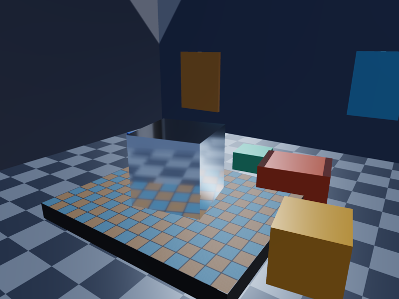

# Phase 29 report: image-based lighting and reflections

Date: 2026-11-11

Commits: implementation remains uncommitted in the working tree

Machine: Windows 10 Pro 22H2, Intel Core i5-6400, Intel HD Graphics 530,
MSVC 19.44 / Visual Studio 2022

## What was built

- Radiance RGBE loading into linear RGBA32F, including flat and scanline-RLE
  encodings, exposure/color-correction metadata, orientation handling, and
  malformed-input validation.
- Equirectangular framebuffer-to-cubemap projection and move-only
  `EnvironmentMap` ownership/build/load APIs for source radiance, filtered
  specular, diffuse irradiance, and the split-sum BRDF LUT.
- Deterministic solid-angle cubemap operations, order-2 spherical harmonics,
  diffuse irradiance filtering, GGX importance-sampled specular prefiltering,
  and BRDF integration.
- Software PBR consumption, reflection-probe blending and box parallax,
  reverse-Z screen-space reflections with optional Hi-Z acceleration and probe
  fallback, procedural Rayleigh/Mie sky capture, and specular occlusion.
- Scene-driven software probe capture through six face-camera callbacks into
  linear RGBA32F/depth targets, plus cubemap-to-environment preprocessing.
- Unit and behavioral acceptance coverage.
- A runnable 3D sample that captures a room into a local reflection probe and
  renders a reflective metallic cube on a textured platform with shadows.

## Decisions

[ADR 0027](../adr/0027-environment-map-ownership.md) proposes an owning
environment aggregate while preserving low-level resource APIs and borrowed
`EnvironmentLighting` views. The owner must outlive those views. The ADR is
pending owner review.

## Evidence for done-when

After the final environment-allocation cleanup and test-cleanup check, the
complete suites passed before scene-capture addition:

- Debug: **134/134**, 209.92 s —
  `ctest --test-dir build\debug --output-on-failure`
- Release: **134/134**, 76.11 s —
  `ctest --test-dir build\release --output-on-failure`

With the final scene-capture validation, the Windows/MSVC Release full suite
passed 134/134 in 62.33 s:

```powershell
ctest --test-dir build\phase28-captures --output-on-failure
```

The targeted image/IBL tests also passed in Debug, Release, and Debug-ASan:

The targeted tests were built with
`cmake --build --preset debug --target cyber_test_software_ibl cyber_test_software_image_load cyber_test_software_ibl_acceptance`
(and the corresponding `release` and `debug-asan` presets). Commands and results:

- Debug: 3/3 passed, 12.55 s
  ```powershell
  ctest --test-dir build\debug --output-on-failure -R 'software_(image_load|ibl|ibl_acceptance)'
  ```
- Release: 3/3 passed, 4.52 s
  ```powershell
  ctest --test-dir build\release --output-on-failure -R 'software_(image_load|ibl|ibl_acceptance)'
  ```
- Debug-ASan: 3/3 passed, 35.22 s. The MSVC ASan runtime directory was added
  to `PATH`.
  ```powershell
  ctest --test-dir build\debug-asan --output-on-failure -R 'software_(image_load|ibl|ibl_acceptance)'
  ```

The scene sample was also built and executed with the Windows/MSVC Release
configuration:

- `cmake --build build\phase28-captures --target cyber_sample_reflections --config Release` — passed.
- `.\build\phase28-captures\samples\11_reflections\cyber_sample_reflections.exe docs\reports\phase-29-scene.ppm` — passed; rendered the room with global 4x4 supersampling, 4x4 supersampled six-face probe capture and linear-light resolve, and a 1024 x 1024 shadow map.
- `ctest --test-dir build\phase28-captures --output-on-failure -R '^software_ibl(_acceptance)?$'` — passed, 2/2.

Acceptance metrics, captured from `software_ibl_acceptance.exe`:

| Check | Measurement | Threshold/control |
|---|---:|---|
| Mirror sphere against environment | mean error 0.00002; worst 0.00225 | mean < 0.02 |
| Rendered sphere against analytic reflection | mean error 0.00047 over 2,876 pixels | mean < 0.05 |
| Incorrect irradiance-as-specular control | mean error 0.91520 | required to exceed 0.02 |
| White furnace | worst error 0.00003 across roughness 0–1 and dielectric/metal cases | worst < 0.04 |
| Probe camera path | worst adjacent step 0.03530 | < 0.05; hard-boundary control 0.88291 |
| SSR mirrored panel | all 9 sampled rays hit the panel in both linear and Hi-Z paths | linear: 120–123 steps; Hi-Z: 34–40 steps |

The test binary also compares every Hi-Z hit against its linear-trace
counterpart. The test-source thresholds are asserted, not merely logged.

The scene preview below is produced by `cyber_sample_reflections`, the
software-renderer sample documented in
[`samples/11_reflections/README.md`](../../samples/11_reflections/README.md).
It captures the actual room geometry into six probe faces, preprocesses the
cubemap for PBR, then renders the room and a metallic cube with the supersampled probe and
reverse-Z shadow map. Both the camera image and the six captured probe faces
use the renderer-wide 4x4 supersampling and Mitchell-Netravali reconstruction:



The 0.00047 analytic mean-error result above is measured by the acceptance
test using its smooth environment fixture; the scene preview is a separate
end-to-end visual sample.

## Scope boundary

- Phase 29 delivers the deterministic software reference path. GPU scene
  rendering, GPU resource upload, and persistent cooked-environment caching
  are outside this phase's acceptance criteria.
- The procedural sky implements single-scattering Rayleigh/Mie.

All Phase 29 build-guide tasks and the documented done-when conditions are
implemented and validated.

## Scene-capture validation

The capture regression renders distinct colored panels into all six cubemap
directions, confirms reverse-Z depth keeps a nearer panel in front of a later
farther draw, builds an `EnvironmentMap` directly from the captured cubemap,
and verifies that a callback failure or target invalidation aborts capture
instead of publishing a partial result. The analytic rendered-sphere acceptance test
also evaluates its surface through a local `ReflectionProbe`.

Commands and results on the Windows/MSVC Release configuration:

- `cmake --build build\phase28-captures --target cyber_test_software_ibl cyber_test_software_ibl_acceptance` — passed.
- `ctest --test-dir build\phase28-captures --output-on-failure -R '^software_ibl$'` — passed, 1/1.
- `ctest --test-dir build\phase28-captures --output-on-failure -R '^software_ibl_acceptance$'` — passed, 1/1.

## Sources used

- [Filament: Physically Based Rendering](https://google.github.io/filament/Filament.html)
- [LearnOpenGL: Diffuse irradiance](https://learnopengl.com/PBR/IBL/Diffuse-irradiance)
- [LearnOpenGL: Specular IBL](https://learnopengl.com/PBR/IBL/Specular-IBL)
- [Unreal Engine: Reflections Environment](https://dev.epicgames.com/documentation/en-us/unreal-engine/reflections-environment-in-unreal-engine)

## What the next phase needs from this one

`EnvironmentMap` provides one lifetime owner for precomputed software
environment resources; `EnvironmentLighting` is its borrowed PBR view.
`ReflectionProbeSet` supports weighted local environments and a fallback.
`CaptureReflectionProbe` supplies the software scene-capture path; `HiZPyramid`
and SSR expose reference behavior for backend comparison. These interfaces do
not imply GPU ownership or Unreal Engine parity.
