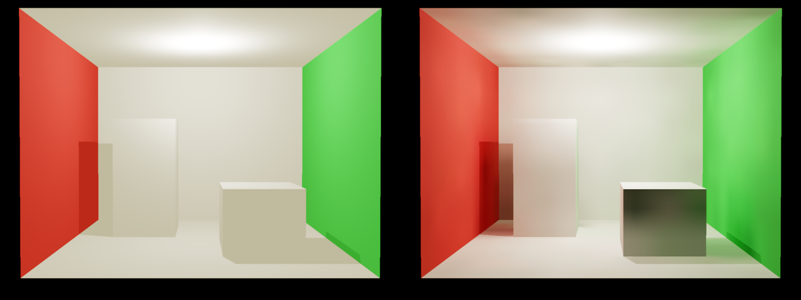
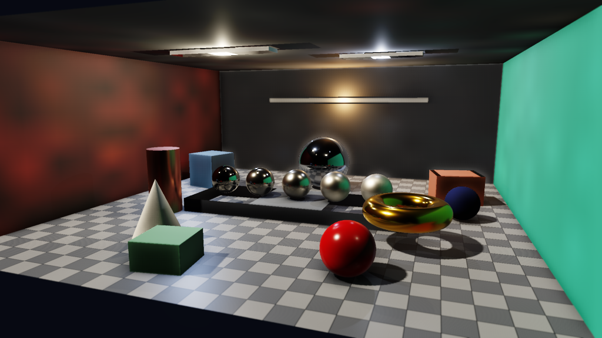
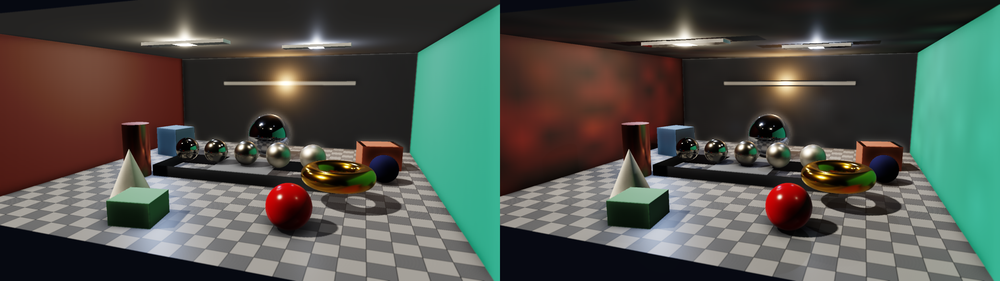
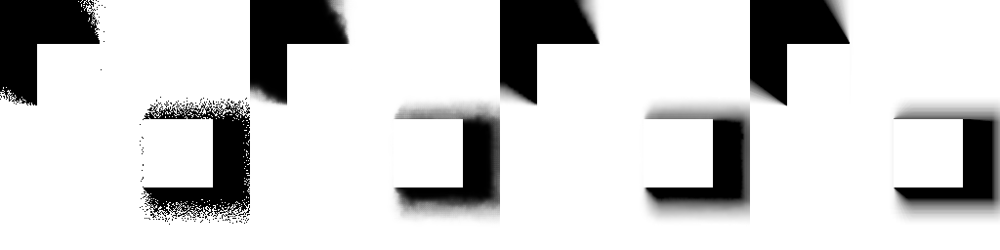

# Phase 31 report: global illumination and ray tracing

Date: 2026-11-13

Commits: implementation remains uncommitted in the working tree

Machine: Windows 10 Pro 22H2, Intel Core i5-6400 (4 cores), Intel HD Graphics
530, MSVC 19.44 / Visual Studio 2022

## What was built

- [ADR 0028](../adr/0028-gi-approach.md), choosing baked irradiance volumes as
  the GI method shipped first and comparing them with lightmaps, screen-space
  GI, and voxel GI on static versus dynamic scenes, memory, and hardware needs.
  It also fixes the acceleration-structure vocabulary and the capability gate.
- `raytrace.h`: a CPU ray tracer in DXR's shape. Bottom-level structures over
  triangles and top-level structures over transformed, masked instances, both
  built with a binned surface-area heuristic and a median fallback, with a
  depth bound that lets every query use a fixed stack. Closest-hit and any-hit
  queries, `TraceRay`, `TraceVisibility`, and `OffsetRayOrigin`.
- `global_illumination.h`: a Lambertian path tracer with next-event estimation
  and Russian roulette; `EstimateIrradiance`; and `IrradianceVolume`, a grid of
  order-2 SH probes with 16 x 16 octahedral visibility-moment maps, baked by
  `BakeIrradianceVolume` with buried-probe classification and sampled with
  normal and Chebyshev visibility weighting.
- Renderer integration: `PbrLightingData::irradianceVolume` answers the diffuse
  ambient term; inside the image-based path it replaces only the environment's
  irradiance through the new `IblSurface::irradianceOverride`, so the specular
  term and its energy split are unchanged.
- `denoise.h`: `SpatioTemporalDenoiser`, after SVGF — depth- and
  normal-tested temporal reprojection with luminance moments, a spatial
  variance estimate for short history, and four passes of edge-aware à-trous
  filtering.
- `gi_quality.h`: `MeasureIrradianceError`, `MeasureLightLeak`, `MeasureNoise`,
  and `MeasureLaplacianEnergy`.
- RHI: `Feature::RayTracing` and `Feature::RayQuery`, reported by the D3D12
  backend from `D3D12_FEATURE_D3D12_OPTIONS5`.
- `cyber/renderer/raytracing_path.h`: `SelectRayTracingPlan`, which resolves a
  policy against reported capabilities per effect, with the rasterized path as
  the fallback and a reason for every fallback.
- `samples/14_global_illumination`: the test scene baked and rendered with and
  without the volume, ray-traced lamp shadows, the denoiser on one-sample
  ray-traced soft shadows, and the policy's answer for every local adapter.
- `samples/15_gallery`: a 20-instance room with a textured floor, a metal
  roughness sweep, chrome, gold, copper, porcelain, plastic, and rubber,
  rendered with the Phase 31 irradiance volume and as an image-based comparison.

## How the work went

Three things came out of measuring rather than assuming, and the report should
say so rather than leave them in a diff.

**The visibility representation was replaced twice.** The first
implementation stored distance moments in six axis lobes. The acceptance
suite's two-room test leaked 7.4% of the lit room's irradiance on average into
the sealed room, 35% at worst: the lobe facing the wall also averaged the
diagonal rays that run past it to the floor and ceiling, so the Chebyshev test
saw a wall that was farther away and fuzzier than it is. An 8 x 8 octahedral
map cut the mean to 1.7% but still leaked 16% at two floor points; per-sample
diagnostics showed both were the points seeing the lit-room probes at an
oblique angle, where the bilinear footprint spanned 35 degrees and reached a
texel looking down the room. 16 x 16 with a cos^32 accumulation lobe — DDGI's
resolution for the same moments — brought the worst case to 0.39%. The leak
threshold was then tightened from 5% to 2%, not loosened.

**Two unit-test expectations were wrong, and the code was right.** The
point-light radiance test expected an exact match, but the shadow ray starts
at a surface-offset origin about 1e-4 closer to the lamp, so the tolerance now
allows exactly that. The furnace probe-distance test forgot that distances
clamp at 1.5 times the probe spacing; it now asserts the clamp, and a corner
probe check asserts the map tells a near wall from a far one.

**The sample's first render was not good enough to show.** At 384 rays per
probe, probes near the lamp — which see a small, very bright ceiling hotspot —
carried visible SH noise at probe spacing, and the exposure clipped. The
sample now bakes 2,048 rays per probe in 1.5 s on four threads and renders at
a lower exposure.

A top-level structure bug was found by the suite too: a member added for
`InstanceId()` was not carried through the move constructor, and the first
moved-into structure dereferenced null. It is fixed, and the instance tests
exercise moved-into structures.

AddressSanitizer found one more, in a test rather than the library: a
stack-use-after-scope in `software_gi_scene_validation`. `CG_EXPECT_EQ` binds
a reference to its argument, and the test passed `.x` of the `Vec3` that
`EstimateIrradiance` returns, so the reference outlived the temporary. Every
check in this phase's tests that compared a member of a returned temporary —
`Stats()`, `RayTracingPlan::For()`, a value-initialized descriptor — now names
the value first. Older suites contain the same pattern on `heap.Stats().used`;
they pass under ASan and were left as they are.

## Evidence for done-when

The roadmap's line: *the chosen GI method runs in the test scene, and the ray
traced path switches on only on GPUs that support it.* The build guide adds
*verified on a second machine*; that part is outstanding, and the reason is in
[Known limits](#known-limits).

### The GI method runs in the test scene, and is right

`software_gi_acceptance_volume_matches_ground_truth` bakes a Cornell-style
room — red and green walls, a white block, a lamp under the ceiling — into an
8 x 6 x 8 volume at 512 rays per probe and four bounces, then compares it with
a 2,048-sample, six-bounce path-traced ground truth at 62 points on the floor,
both coloured walls, and the block's top.

| Configuration | Mean rel. error | Max rel. error | Bias | Energy ratio |
|---|---|---|---|---|
| Baked volume | 0.059 | 0.175 | −0.010 | 0.988 |
| Control: zero bounces | 0.542 | — | −0.542 | 0.462 |

Thresholds: mean error below 0.12, energy within ±8%, fewer than 10% of
samples above 35% error. The control fails the energy bar by a factor of two.
The block buried 8 of the 384 probes, and all 8 were classified `Inside` and
excluded. Colour bleeding is asserted directly: the floor beside the red wall
reads red over green by 1.52, and beside the green wall green over red by 1.42.

The sample renders the same idea through the rasterizer:



Left: the best constant ambient term, the mean indirect irradiance over the
floor. Right: the baked volume. Same lamp, geometry, and exposure. The red
and green bleed, the darkened corner behind the tall block, and the short
block's face going dark are all indirect light. That face is dark because it is
right: the lamp is behind its plane and the floor in front of it lies in the
block's own shadow.

### Rich material gallery

The gallery sample makes the Phase 31 lighting visible on varied shapes and
surfaces. It writes the baked-irradiance frame separately and a side-by-side
comparison against the image-based lighting path. The room has 28,974
triangles in 20 instances; the bake uses 1,183 probes at 768 rays per probe.





Run it with `cmake --build --preset release --target cyber_sample_gallery`,
then `.\build\release\samples\15_gallery\cyber_sample_gallery.exe`. The
sample writes `gallery.ppm`, `gallery_compare.ppm`, and `gallery_ibl.ppm` to
the current directory.

### Light does not leak through walls

`software_gi_acceptance_no_light_leak_through_walls` builds two rooms sharing
a 0.1-thick wall, lights only one, and places the lattice so probes sit 0.35
either side of the wall. The sealed room's ground truth is exactly zero.

| Lookup | Mean leak | Max leak | Samples above 2% |
|---|---|---|---|
| Visibility and normal weighting | 0.0004 | 0.0039 | 0 / 18 |
| Control: both off | 0.2143 | 0.3931 | 18 / 18 |

The lit side by the same wall is not darkened by the suppression: 4.093 baked
against 4.132 ground truth.

### The ray-traced path switches on only where it is supported

`renderer_raytracing_path` tests the policy against fabricated capability
sets: no ray tracing falls back with `Unsupported`; tier 1.0 selects the
pipeline; tier 1.1 selects inline queries; `RayQuery` without `RayTracing` is
treated as no support; every preference and the default effect set behave as
documented; and the null device reports nothing. It then opens every D3D12
adapter on the machine and checks the reported set is self-consistent and the
plan agrees with it:

```text
[raytracing] adapter 0 "Intel(R) HD Graphics 530": ray_tracing=0 ray_query=0 -> shadows rasterized
[raytracing] adapter 1 "Microsoft Basic Render Driver": ray_tracing=0 ray_query=0 -> shadows rasterized
```

In this build a capable adapter also rasterizes, reporting `NotImplemented`:
`kHardwareRayTracingCompiledIn` is `false`, because no GPU path exists to
switch on. The tests assert that too.

### The ray-traced signal is usable once denoised

`software_gi_acceptance_denoised_ray_traced_shadow` traces one shadow ray per
pixel from a floor toward a disk light past a blocker, and compares against a
256-sample stratified reference.

| Signal | Relative RMSE | Relative bias | Laplacian energy |
|---|---|---|---|
| Raw, 1 spp (control) | 0.160 | +0.0005 | 0.187 |
| Denoised, 1 frame | 0.029 | +0.0054 | 0.009 |
| Denoised, 8 frames | 0.017 | +0.0040 | 0.003 |

Thresholds: 6% for one frame, 3.5% for eight, bias within 2%. The sample shows
the same on the test room seen from above:



## Test suites

New suites, all passing:

| Suite | Tests | What it covers |
|---|---|---|
| `software_raytrace` | 11 | Hit attributes, validation, BVH against brute force (3,000 triangles, 2,000 rays, zero mismatches, under 5% of a sweep's triangle tests), determinism, leaf-size invariance, coincident and degenerate geometry, moves, instances with non-uniform scale, masks, the top level against an instance sweep, visibility queries |
| `software_global_illumination` | 12 | Exact white furnace, roulette convergence, directional and point lights, sky, shadowing, scene validation, determinism, octahedral mapping, volume layout, constant-field bake, buried-probe classification, bake validation, job-system byte identity, PBR integration |
| `software_denoise` | 7 | Validation, clean-signal passthrough, spatial noise reduction with edge preservation and a blind control, temporal convergence and history caps, disocclusion rejection with a control, velocity reprojection, job-system byte identity |
| `software_gi_quality` | 3 | Each metric responds to the defect it measures |
| `software_gi_acceptance` | 3 | The three measured properties above, each with its control |
| `renderer_raytracing_path` | 8 | The capability gate, preferences, effect opt-in, malformed capabilities, the build without GPU paths, names, null and D3D12 devices |

`software_public_headers`, `renderer_public_headers`, and `rhi_capabilities`
gained Phase 31 checks.

| Configuration | Result |
|---|---|
| Debug | 144/144 in 190.8 s |
| Release | 144/144 in 65.7 s |
| Debug-ASan | 144/144 in 524.7 s |

The baseline before this phase was 138/138 in Debug.

Repository checks: `check_structure.py` and `layer_check.py` pass. Every file
this phase added or edited is clean under `clang-format`. `check_format.py`
reports violations in four files, all predating this phase and untouched by it:
`shadow_pass.h`, `shadow_pass.cpp`, and `shadow_pass_test.cpp` in
`cyber_renderer`, and `d3d12_textures.cpp` in `cyber_rhi`.

## Known limits

- **No GPU ray tracing.** Acceleration-structure builds, dispatch, inline
  queries, and shader tables are not implemented. The development adapter
  cannot run them, so they could not be verified, and an unverified GPU path
  in the frame is worse than a documented absence. The capability report and
  the policy are complete; the GPU path is the next step on a capable machine.
- **No second-machine verification.** The build guide asks for the ray-traced
  path to be verified on a second, capable machine. None is available. The
  gate is verified on this machine's two adapters, both incapable, and against
  fabricated capability sets.
- **Static indirect light.** Moving geometry or lights invalidates the bake.
- **Probe-scale detail.** Contact occlusion comes from SSAO, and surfaces next
  to buried probes show mild variation at probe spacing.
- **Lambertian bake.** Glossy interreflection is not captured.
- **No lightmaps**, by the decision in ADR 0028.
- **The denoiser does not clamp history** against the current neighbourhood,
  so a lighting change under a still camera converges at the accumulation rate;
  a caller resets it on a cut.
