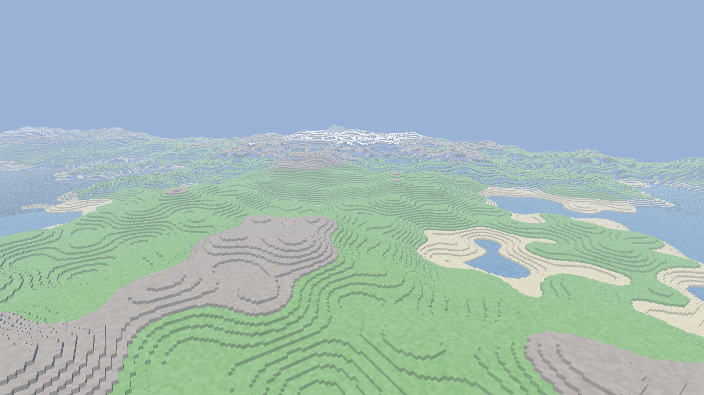

# Phase 32 report: GPU-driven rendering and compute

Date: 2026-11-13

Commits: implementation remains uncommitted in the working tree

Machine: Windows 10 Pro 22H2, Intel Core i5-6400 (4 cores), Intel HD Graphics
530 (driver 31.0.101.2125), Microsoft Basic Render Driver (WARP), MSVC 19.44 /
Visual Studio 2022

## What was built

- RHI: real indirect execution on D3D12. `DrawIndirect`, `DrawIndexedIndirect`,
  and `DispatchIndirect` record `ExecuteIndirect` through per-device command
  signatures instead of returning `Unsupported`, and the new
  `DrawIndirectCount` and `DrawIndexedIndirectCount` read the draw count from a
  GPU buffer, clamped to a CPU-side maximum, behind
  `Feature::IndirectDrawCount`. The null and validating backends implement and
  check them too.
- RHI: `Feature::MeshShaders`, reported from the driver's mesh-shader tier.
- `cyber/renderer/gpu_driven.h`: `GpuDrivenScene` (instances, draw groups with
  up to four LODs, batches), the GPU data layouts, `HiZPyramid` and
  `TestHiZOcclusion`, `CullInstancesReference` and `DecideGpuInstance` — the
  culling shader's arithmetic on the CPU, with decision margins — and the
  `SelectGeometryPath` and `SelectAsyncComputePlan` policies.
- `cyber/renderer/gpu_culling_pipeline.h`: `GpuCullingPipeline`, three compute
  pipelines — Hi-Z reduction, instance culling, ordered draw compaction — and
  the commands that run them on a graphics or compute queue and draw the
  result with one `DrawIndexedIndirectCount`.
- `cyber/renderer/gpu_light_culling.h`: `GpuLightCullingPass`, Phase 27's
  cluster light lists built by a compute shader as a conservative superset of
  the CPU lists.
- `cyber/renderer/meshlet.h`: `BuildMeshlets`, `CullMeshlet` (sphere and
  normal cone), `CullMeshletsReference`, and `ExpandMeshletsToIndices`, the
  vertex-pipeline fallback.
- `samples/17_gpu_driven`: a million-instance voxel landscape culled,
  LOD-selected, and drawn this way.

## How the work went

The GPU path was built against a CPU oracle from the start, and the oracle
against Phase 22, so every defect below surfaced as a count that did not match
rather than as an image that looked wrong.

**The D3D12 backend had never drawn a point.** The first indirect-count test
lit no pixels at all — not even for the plain `DrawIndirect` beside it — on
both adapters. `SetPipeline` set a triangle-list topology on every bind; a
pipeline state fixes only the topology type, so the point pipeline was fed
triangles and rasterized nothing. Every earlier D3D12 test used triangles. The
pipeline now records its topology and the list sets it. With that fixed, the
indirect-count cases — GPU count below, above, and equal to the CPU maximum,
and zero — lit exactly the expected identifiers.

**Two compute passes writing one buffer were not ordered.** The backend
dropped any transition whose two states were equal, so `ShaderWrite` to
`ShaderWrite` recorded nothing where a UAV barrier was needed between culling
and compaction, and between Hi-Z levels. It records one now.

**A compute list could not be closed.** The first async-compute frame failed
at `End()` with no message. `ShaderRead` maps to both shader-resource states,
and a compute list may not name the pixel-shader one; `Close` rejects the list
without saying why. On compute lists the backend now names only the non-pixel
state.

**WARP disagreed with the CPU on 1,688 of 200,000 occlusion tests; the HD
Graphics 530 on none.** All of WARP's disagreements kept an instance the CPU
culled, at the silhouette edges of the occluding wall, and 489 of them were
too far from any decision boundary to be rounding. Reading the pyramid back
showed it identical to the CPU's on every level; splitting the build and the
cull into separate submissions changed nothing. A temporary dump of the
shader's intermediate values for one disagreeing box settled it: both adapters
computed the same screen rectangle, spanning texels 39-40 by 94-95, but WARP
read pyramid level 1 where the level-selection loop — the smallest `l` with
`(x1 >> l) - (x0 >> l) <= 1` — requires level 0. The shader now steps the
coordinates down one level at a time with constant one-bit shifts, which is
the same function, and WARP agrees with the CPU on every instance. The CPU
reference uses the same form. What inside WARP produced the coarser level was
not isolated. Replacing the level table in the constant buffer with levels
derived in the shader was tried first and made no difference; it was kept
because it removes a dynamically indexed constant-buffer array and 256 bytes
of constants.

**One test expectation was wrong.** The meshlet test assumed meshlets would
be near-full in triangles. On a sphere's strips the 64-vertex limit binds
first — 149 of 150 meshlets closed on vertices — so the count was twice the
triangle-bound minimum, correctly. The test now asserts the greedy invariant
itself: every meshlet but the last is full in one limit or the other.

**WARP under GPU-based validation needs about two minutes per
million-instance frame.** The debug layer's GPU-based validation instruments
every shader access. Rather than add a quarter of an hour to the Debug suite,
the million-instance tests run at full size on hardware adapters and on a
tenth of the scene on WARP, through identical code.

## Evidence for done-when

The roadmap's line: *a scene with 1,000,000 objects is culled on the GPU and
drawn with a handful of calls, and CPU time stays flat as object count
grows.* The build guide adds *and the results match the CPU culler.*

### A million objects are culled on the GPU

`gpu_driven_d3d12_culls_a_million_instances_like_the_cpu` uploads a million
boxes in sixteen draw groups with one to four LODs — 40 batches — and culls
them against a perspective view on each adapter.

| Adapter | Instances | Visible (GPU) | Visible (CPU) | Draws | Dispatches | Disagreements | Submit to idle |
|---|---|---|---|---|---|---|---|
| HD Graphics 530 | 1,000,000 | 614,779 | 614,779 | 40 | 2 | 0 | 10.1 ms |
| WARP | 100,000 | 61,462 | 61,462 | 31 | 2 | 0 | 49.5 ms |

"Submit to idle" includes copying the 10 MB visible list and the arguments to
readback memory.

### The results match the CPU culler

Three comparisons, each exact:

- **Reference against Phase 22.** The same test culls the same million with
  `Scene::Cull`: 614,779 visible, and every one at the LOD the reference
  chose. `gpu_driven_reference_matches_phase22_scene_cull` repeats it from
  three cameras over 120,000 instances in twelve groups — 163,774 visible, with
  40,854 / 41,841 / 54,943 / 26,136 at LODs 0-3 — with zero mismatches, and
  with and without a four-worker job system, byte for byte.
- **GPU against reference, per instance.** Every instance's verdict and LOD
  read back from the GPU's visible lists equals the reference's, on both
  adapters. A disagreement would be accepted only if the CPU's decision margin
  showed it within rounding of the GPU's divide or square root; there were
  none to accept. Because compaction is ordered, the GPU's draw arguments equal
  the reference's byte for byte.
- **Occlusion, per instance.**
  `gpu_driven_d3d12_occlusion_culling_matches_the_reference` builds the Hi-Z
  pyramid on the GPU from a wall's depth and culls with occlusion on: 85,613
  occluded and 21,453 visible of 200,000 on the HD Graphics 530, and 8,612 and
  2,140 of 20,000 on WARP, each equal to the CPU's, instance by instance.

### Drawn with a handful of calls

`gpu_driven_d3d12_draws_a_culled_million_with_one_call` culls a million and
draws them with a point pipeline that writes one texel per instance
identifier, then reads the target back.

| Adapter | Draw calls | Indirect draws | Instances drawn | Wrong texels |
|---|---|---|---|---|
| HD Graphics 530 | 1 | 38 | 615,546 | 0 |
| WARP (100,000) | 1 | 27 | 61,561 | 0 |

Every lit texel is an instance the culler kept and every kept instance lit its
texel, which checks the whole chain: the arguments, the GPU-written count, and
each draw's `firstInstance` offsetting the visible-instance stream. The
frame's commands: two dispatches, one draw.

The sample renders the same thing as an image — a 1000 x 1000 voxel
landscape, every column a cube:



```text
adapter:   Intel(R) HD Graphics 530
instances: 1000000 described, 641518 in view (358482 frustum-culled)
LODs:      102202 cubes, 441853 octahedra, 97463 tetrahedra
commands:  2 culling dispatches, 1 draw call carrying 3 indirect draws
CPU:       0.549 ms median to record culling and the draw
frame:     51.09 ms median submit to completion
```

Run it with `cmake --build --preset release --target cyber_sample_gpu_driven`,
then `.\build\release\samples\17_gpu_driven\cyber_sample_gpu_driven.exe`.

### CPU time stays flat as object count grows

`gpu_driven_d3d12_cpu_time_stays_flat_as_objects_grow` times what the render
thread does per frame — write the cull constants, record culling, the
acquire barriers, the pass, and the indirect draw, end the list, submit — and
stops the clock at submission, so the GPU's time is excluded. Medians of 25
frames on the HD Graphics 530, Release:

| Instances | GPU-driven | CPU-driven control |
|---|---|---|
| 1,000 | 0.513 | 0.430 |
| 10,000 | 0.494 | 1.603 |
| 100,000 | 0.831 | 16.932 |
| 1,000,000 | 0.532 | — |

The control culls on the CPU with the reference culler and records one draw
per visible instance, the frame Phase 22 and Phase 23 would build. The test
asserts the GPU-driven time at a million is at most twice the time at a
thousand plus 0.25 ms, and that the control at 100,000 is at least twenty
times its time at 1,000. The control fails the first bar by two orders of
magnitude. The GPU-driven figures are flat to within scheduler noise — the
100,000-instance median is the largest of the four, and the million-instance
median the second smallest; the work recorded is identical at every size.

### Hi-Z occlusion is conservative

`gpu_driven_hiz_occlusion_is_conservative` projects 20,000 random boxes
against a pyramid of three overlapping occluders: 5,060 occluded, 11,631
visible, 3,309 untestable. For every box called occluded, its depth is checked
against the level-0 depth under every pixel its rectangle covers; there are no
violations. `gpu_driven_hiz_texels_are_the_farthest_depth_below` checks every
texel of a 97 x 61 pyramid against a brute-force minimum, and
`gpu_driven_d3d12_hiz_build_matches_the_cpu_pyramid` finds the GPU's 19,598
texels bitwise equal to the CPU's on both adapters, in nine dispatches.
`gpu_driven_occlusion_culls_instances_behind_a_wall` culls all 300 instances
behind a wall and keeps all 40 in front of it and beside it.

### Async compute

`gpu_driven_d3d12_async_compute_culling_matches_the_graphics_queue` culls a
million instances on the compute queue and draws on the graphics queue behind
a fence. The image equals the single-queue frame's texel for texel, and the
debug layer — with GPU-based validation, in Debug — reports nothing about the
hand-off. Measured as the build guide asks, medians of 12 frames each way:

| Adapter | One queue | Async compute | Gain | `Auto` keeps it |
|---|---|---|---|---|
| HD Graphics 530 | 48.4 ms | 49.0 ms | −1.1% | no |
| WARP (100,000) | 19.4 ms | 19.0 ms | +2.1% | no |

A second run on the HD Graphics 530 measured +0.5%. Both are within noise and
below the policy's 5% bar, so `Auto` stays on the graphics queue. The
frame is dominated by rasterizing 600,000 points on a 1024 x 1024 target,
which leaves the compute work little to overlap with on an integrated GPU.

`gpu_driven_d3d12_light_and_instance_culling_share_the_compute_queue` runs
instance culling, compaction, and the cluster light-list build as three
dispatches in one compute submission. On both adapters the 22,080 GPU cluster
lists contain every light `BuildClusterLightLists` assigns — 197,705 GPU
entries over 168,329 CPU entries, the difference being the one-slice widening —
with none omitted and none overflowing.

### Mesh shaders where supported

Neither local adapter reports a mesh-shader tier:

```text
adapter "Intel(R) HD Graphics 530": mesh shaders not reported, geometry path vertex_pipeline (unsupported), compute queue present
adapter "Microsoft Basic Render Driver": mesh shaders not reported, geometry path vertex_pipeline (unsupported), compute queue present
```

The mesh-shader pipeline is not built — see [Known limits](#known-limits) —
and `SelectGeometryPath` is tested against fabricated capability sets: a
capable adapter in this build resolves to the vertex pipeline with
`NotImplemented`. The meshlet half is complete and measured:

- `meshlet_build_respects_limits_and_keeps_every_triangle`: a 9,024-triangle
  sphere in 150 meshlets, none over 64 vertices or 124 triangles, every one but
  the last full in one limit, and expanding all of them returns the original
  index list in order.
- `meshlet_culling_is_conservative`: from 64 cameras, 4,269 back-face-culled,
  1,754 frustum-culled, and 10,531 visible meshlet tests, with every triangle
  of every culled meshlet checked by brute force; no violations.
- `meshlet_fallback_keeps_every_front_facing_triangle`: the expanded survivors
  drop 32.2% of a sphere's triangles and keep every front-facing one.

## Test suites

New suites, all passing:

| Suite | Tests | What it covers |
|---|---|---|
| `renderer_gpu_driven` | 12 | Scene validation and batch capacities; the reference against Phase 22 and its threading independence; ordered compaction; Hi-Z layout, texels, and conservativeness; occlusion behind a wall with a control; both policies; meshlet limits, culling, and fallback |
| `renderer_gpu_driven_d3d12` | 9 | Capabilities; indirect-count clamping and `firstInstance`; GPU culling against the CPU at a million; one-call drawing read back; the GPU Hi-Z build; GPU occlusion; async compute; flat CPU time with a control; light and instance culling in one compute submission |

`rhi_command_list` gained `rhi_command_list_indirect_count_rules`;
`renderer_public_headers` and `rhi_capabilities` gained Phase 32 checks.

| Configuration | Result |
|---|---|
| Debug | 146/146 in 1053.9 s, of which `renderer_gpu_driven_d3d12` 870.6 s |
| Release | 146/146 in 78.5 s |

The baseline before this phase was 144/144 in both. The Debug suite's time
grew from 190.8 s to 1053.9 s, almost all of it the D3D12 suite under
GPU-based validation, which instruments every shader access of the
million-instance frames on the HD Graphics 530. Release runs it in about
eleven seconds. The Debug D3D12 suite runs
with the debug layer and GPU-based validation, and four of its tests fail on
any message the layer reports; none did.

Repository checks: `check_structure.py` and `layer_check.py` pass. Every file
this phase added or edited is clean under `clang-format`. `check_format.py`
reports violations in three files, all predating this phase and untouched by
it: `shadow_pass.h`, `shadow_pass.cpp`, and `shadow_pass_test.cpp` in
`cyber_renderer`.

## Known limits

- **No mesh-shader pipeline.** Mesh and amplification shaders need shader
  model 6.5, which only DXC compiles; the RHI compiles HLSL with `D3DCompile`,
  limited to 5.1 (ADR 0019). Neither local adapter reports a mesh-shader tier,
  so a pipeline built now could not be verified here. Meshlets, their culling,
  the capability check, and the fallback are complete.
- **One frame of occlusion latency.** Culling uses the previous frame's depth;
  two-phase occlusion is the next step.
- **Async compute was not shown to help here.** It works and is fenced
  correctly; on this integrated GPU it measures within noise, and the policy
  declines it. It is the policy, not a fixed choice, that a faster GPU would
  change.
- **Outside the render graph.** The pipeline tracks its own buffer states in
  recording order rather than being scheduled by the graph.
- **Light lists are built, not yet consumed** by a GPU forward pass.
- **WARP's level-selection behaviour** was worked around, not explained.
