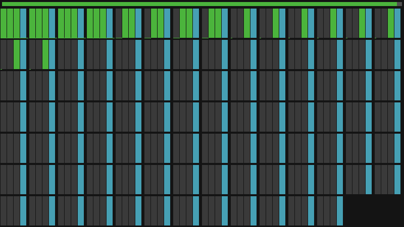

# Phase 33 report: Texture compression and streaming

Date: 2026-11-14

Commits: implementation remains uncommitted in the working tree

Machine: Windows 10 Pro 22H2, Intel Core i5-6400 (4 cores), Intel HD Graphics
530, MSVC 19.44 / Visual Studio 2022, release preset

## What was built

- `cyber/assets/bc_codec.h`: BC1, BC4, BC5 and BC7 block decoders (the
  reference output) and encoders; `CompressTexture` / `DecompressTexture` for
  whole textures with mips and layers; `GenerateMipChain` with sRGB-correct
  filtering; `ComputePsnr`.
- `cyber/renderer/texture_streaming.h`: `TextureStreamer`, a residency manager
  over a 64 KiB page pool with a packed, never-evicted mip tail as the
  placeholder, coverage-ordered requests, background IO threads at
  below-normal priority, budgeted eviction that never thrashes, a per-frame
  upload limit, and recycled staging. `ComputeWantedMip` turns screen size into
  a mip. `RenderResidencyView` draws what is loaded.
- `cyber/platform/thread.h`: `Thread::SetCurrentThreadPriority`.
- `samples/18_texture_streaming`: 400 textures, 1.07 GiB of BC1 data, a 64 MiB
  budget, a 30-second flythrough paced at 60 Hz.

Design: [phase-33-compression-streaming.md](../design/phase-33-compression-streaming.md).

## Performance work done alongside

The phase started with a profiling pass on the software renderer, which the
interactive samples draw with. The issues found and fixed:

| Issue | Effect | Fix |
|---|---|---|
| Every draw allocated and freed ~0.5 MB of transient arrays (clipped triangles, prepared triangles, tile bins) | Windows returned the pages each time: 29 page faults and ~0.1 ms per 576-triangle draw | Per-thread grow-only scratch arena (`scratch_allocator.h`); 0 faults per draw |
| Two guard-band clip arrays of `ShadedClipVertex` constructed per triangle | Default member initializers ran for ~20 vertices per triangle, clipped or not | Hoisted out of the triangle loop |
| `std::isfinite` (a CRT call on MSVC) and `std::lround` in per-pixel and per-vertex code | Out-of-line calls in the hottest loops | `math::IsFinite` is now a constexpr exponent test; snapping rounds inline with lround's exact result |
| `PackPresentPixels` rebuilt a 16,641-entry sRGB table (one `pow` each) per frame, then packed scalar | ~1 ms of `pow` per frame plus a slow loop | Table built once; SSE2 packing, bit-identical to the scalar path |
| `EvaluatePointShadowVisibility` did face selection and seam weights before noticing a light has no shadow maps | ~8% of busy time with unshadowed point lights | Early out |
| Fresnel `std::pow(x, 5)` per light per pixel | Library call | Multiplications |
| `ParallelBatch` read `state->system` after decrementing `remaining`, which lets `ParallelFor` return and destroy `state` | Use-after-return race in the job system | Read the pointer first, notify only on the last decrement |
| `ParallelFor` caller blocked while workers woke | A thread idle and a wake-up per parallel loop | The caller runs a share of the batches |

Measured with `cyber_software_frame_bench` (mean frame time, ms):

| Workload | Before | After |
|---|---|---|
| flat, 320x180 | 23.07 | 9.58 |
| flat, 1280x720 | 30.68 | 24.10 |
| pbr, 320x180 | 22.53 | 13.66 |
| pbr, 1280x720 | 79.17 | 51.18 |
| pbr + 4 point lights, 320x180 | 32.22 | 18.59 |
| pbr + 4 point lights, 1280x720 | 171.74 | 96.95 |
| per-draw fixed cost, 576 triangles, jobs on | 0.426 | 0.240 |

Present packing at 1280x720 went from 7.2-8.1 ms to 3.7-4.1 ms in
`02_raster` and `03_depth`. `04_textured` at 1x supersampling went from 38.1
to 45.4 FPS. Frames remain fill-rate bound where they shade millions of
samples: the default 2x2 supersampling of `04_textured` renders 3.7 million
samples a frame and runs at about 14 FPS; that is the cost of the quality
setting, not a defect.

A test was also fixed: `software_gi_bake_is_deterministic_across_jobs`
compared probes with a whole-struct `memcmp`, including the three padding bytes
after the `u8` state. Their contents are whatever the baking thread's stack
held, so the test passed or failed by accident of thread layout. It now
compares every member bit-exactly; the probe values were always identical.

## Evidence for done-when

### The encoder PSNR tests pass

`assets_bc_codec` (12 tests) checks the decoders against hand-built blocks with
values worked out from the specification, solid colours round-tripping exactly
through BC7 and BC4, BC4's six-value mode keeping exact 0 and 255, BC1
punch-through alpha, deterministic output, layouts for odd sizes and mip
chains, and sRGB mip filtering. The PSNR floors on a 128x128 test card:

| Format | Quality | Measured | Floor |
|---|---|---|---|
| BC1 | Normal | 37.44 dB | 37.0 dB |
| BC4 | Normal | 51.72 dB | 51.0 dB |
| BC5 | Normal | 51.68 dB | 51.0 dB |
| BC7 opaque | Fast / Normal / High | 43.48 / 43.53 / 43.62 dB | 43.0 dB, non-decreasing |
| BC7 with alpha | Normal | 40.08 dB | 39.5 dB |

### More texture data than the budget runs without hitches

`cyber_sample_texture_streaming`, two consecutive runs:

```text
texture streaming: 400 textures, 1066.7 MiB of texture data, budget 64.0 MiB (16.67x oversubscribed)
after level load: tails resident 16.67 MiB in 400 pages, 0 textures without a tail
frames 1800: streaming update mean 0.207 ms, p99 0.646 ms, max 0.855 ms; 0 hitches over 2.0 ms
budget: peak 1024 of 1024 pages (100.0%), 1478 uploads (949.4 MiB), 1021 evictions
view: mean 1.48 missing levels across visible panels, worst 6; 0 frames had a texture without its tail
PASS: oversubscribed scene streamed within budget without hitches

frames 1800: streaming update mean 0.214 ms, p99 0.704 ms, max 1.186 ms; 0 hitches over 2.0 ms
```

The budget is full for most of the run and is never exceeded; 949 MiB move
through a 64 MiB pool. Every frame can draw every texture (its tail is always
resident), and the view trails what it needs by about 1.5 levels summed over
all visible panels while the camera moves at 12 m/s.

How "without hitches" was reached is part of the evidence. The first runs had
spikes of 4-7 ms. The slowest-frame breakdown the sample prints showed three
causes, each fixed in the streamer or the sample's configuration rather than
hidden:

1. Frames that uploaded two top mips (4 MiB) at once: the sample's upload
   budget is now one top mip, 2 MiB, per frame.
2. Frames that allocated or freed 2 MiB staging blocks: staging is now
   recycled.
3. Frames with no streaming work at all that still took 3-5 ms: the main
   thread was being preempted by the IO threads on this 4-core CPU. IO threads
   now run at below-normal priority and the sample's main thread above normal,
   as a game's would. With the main thread at normal priority the worst frame
   is still 4.9 ms, with nothing done in it.

### The residency view shows what is loaded



The 96 panels ahead of the camera, nearest first. The budget bar across the top
is full. The nearest panels hold every level (green); resolution falls off with
distance, levels a panel does not need are grey, and every tail is resident
(teal).

## Test suites

- `assets_bc_codec`: new, 12 tests.
- `renderer_texture_streaming`: new, 10 tests — tail first as one request,
  coarse-to-fine order, budget held with important textures winning, surplus
  evicted before needed levels, equal textures not trading memory, unused
  textures giving way, per-frame upload bound, failed reads retried, unregister
  releasing pages and staling handles, the residency view's colours. Every
  upload is checked for the right bytes and no page is ever mapped twice. It
  passed 20 consecutive runs.
- `platform_thread`: a priority test added.
- `assets_public_headers` and `renderer_public_headers` include the new headers.
- Full suite: 148 of 148 pass. `renderer_gpu_driven_d3d12`'s CPU-flatness
  ratio check failed once under `ctest -j4`, while three other tests competed
  for the CPU, and passes three of three when run alone; it measures wall-time
  ratios and is load-sensitive.

## Known limits

- The page pool is not bound to D3D12 reserved resources yet; the RHI has no
  tiled-resource API. The streamer hands its sink page lists so that binding
  does not change the streamer.
- BC7 searches modes 0, 1, 3, 5 and 6; modes 2, 4 and 7 and channel rotation
  are not searched.
- An experimental CPU virtual-texture cache and sample are implemented, but
  are not part of the measured residency acceptance above. Binding its page
  cache to D3D12 reserved resources and collecting GPU sampler feedback remain
  future work.
- Wanted mips come from analytic coverage, not GPU sampler feedback, which the
  development adapter does not support.
