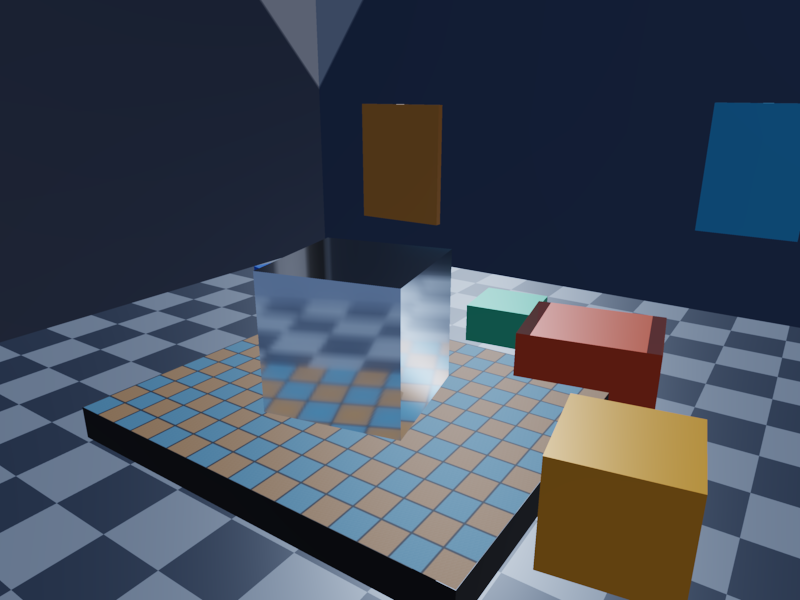

# 11_reflections — captured 3D environment

Builds a small room from software-rendered geometry, captures it into a six-face
local reflection probe, and renders a polished metallic cube on a raised,
procedurally textured tile platform. The cube reflects the captured room,
platform, and colored props. A reverse-Z shadow map covers the cube, platform,
and room geometry. The camera render uses the renderer-wide default
anti-aliasing path: 4x4 supersampling with Mitchell-Netravali reconstruction,
resolved in linear HDR before tone mapping. Probe capture and shadow-map
generation are separate passes; probe faces also use 4x4 supersampling and
linear-light Mitchell resolve before cubemap filtering, so reflected geometry
edges are anti-aliased as well.

## Build and run

From the repository root:

```powershell
cmake --preset release
cmake --build --preset release --target cyber_sample_reflections
.\build\release\samples\11_reflections\cyber_sample_reflections.exe
```

The sample writes `reflections.ppm` in the current directory. Open that image
to inspect the rendered scene. Pass an output path as the first argument to
choose another destination:

```powershell
.\build\release\samples\11_reflections\cyber_sample_reflections.exe C:\temp\reflections.ppm
```


