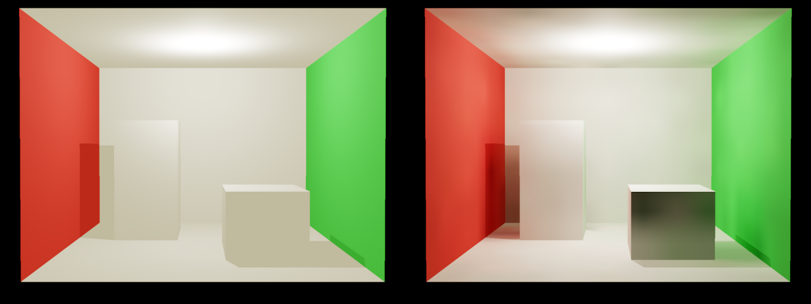
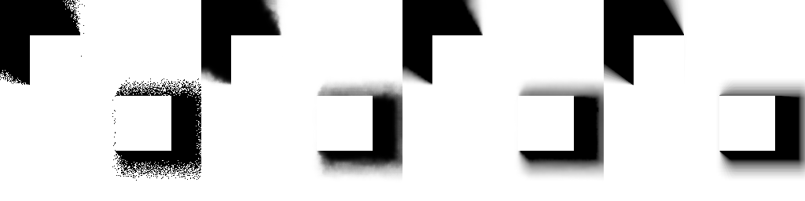

# 14_global_illumination — baked irradiance volume and ray-traced shadows

Bakes a Cornell-style room into an irradiance volume with the CPU path tracer,
then renders it twice through the software rasterizer: on the left with the
best flat ambient term a constant can give (the mean indirect irradiance over
the floor), on the right with the baked volume. Same lamp, same exposure, same
geometry; the difference is the distribution of indirect light — the red and
green walls bleeding onto the floor and the blocks, the corner behind the tall
block darkening, the box face that sees only shadowed floor going dark.

Direct light from the lamp is shadowed by one ray per sample against the same
bounding-volume hierarchy the bake used. That is the `SoftwareReference`
ray-traced shadow technique, and it is what this sample uses on every machine.

A second image shows the ray-tracing denoiser on the same room, seen from
straight above: one shadow ray per pixel toward a disk light, then one denoised
frame, eight accumulated frames, and a 256-sample converged reference.

Finally, the sample opens every Direct3D 12 adapter it can and prints which
technique the ray-tracing policy selects for shadows there. On an adapter
without `D3D12_RAYTRACING_TIER_1_0` the answer is `rasterized (unsupported)`;
on a capable adapter in this build it is `rasterized (not_implemented)`,
because the GPU ray-tracing path is not part of Phase 31.

This is the Phase 31 bar made visible: the chosen GI method running in the test
scene, and the ray-traced path gated by what the hardware reports.

## Build and run

From the repository root:

```powershell
cmake --preset release
cmake --build --preset release --target cyber_sample_global_illumination
.\build\release\samples\14_global_illumination\cyber_sample_global_illumination.exe
```

The sample writes `global_illumination.tga` and `global_illumination_denoise.tga`
into the current directory. Pass an output path as the first argument to choose
another destination; a `.ppm` extension selects Netpbm output, and the
denoiser image takes the same name with `_denoise` before the extension:

```powershell
.\build\release\samples\14_global_illumination\cyber_sample_global_illumination.exe C:\temp\gi.ppm
```

On the development machine (Intel Core i5-6400, four threads, Release) the run
prints:

```text
Ray-traced soft shadow, 1 spp, relative RMSE against 256 spp: raw 0.162, denoised 1 frame 0.026, 8 frames 0.015.
Room: 34 triangles in 5 instances, BVH 1440 bytes.
Bake: 567 probes (525 valid, 42 inside geometry), 2048 rays per probe, 4 bounces, 3076613 path rays, 1528 ms, 1226988 bytes.
Render: two 640x480 frames, 2x2 supersampled, ray-traced lamp shadows, 3732 ms.
Ray tracing on adapter 0 "Intel(R) HD Graphics 530": capable no, inline no -> shadows rasterized (unsupported)
Ray tracing on adapter 1 "Microsoft Basic Render Driver": capable no, inline no -> shadows rasterized (unsupported)
```




