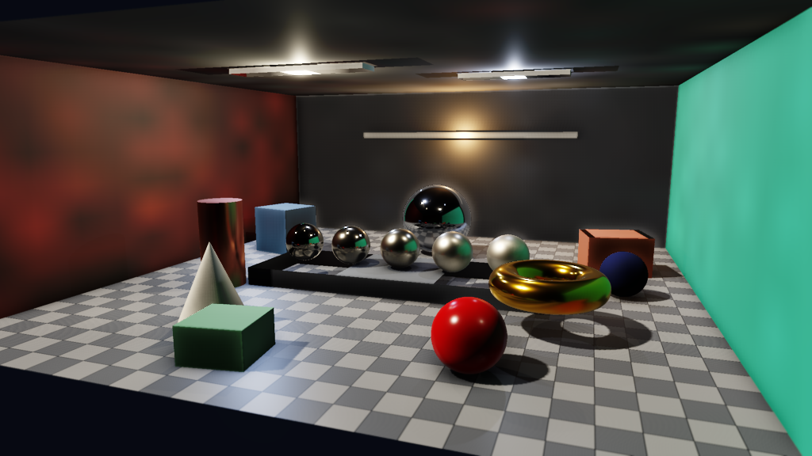
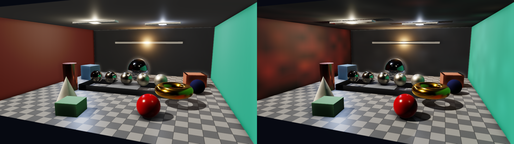

# 15_gallery — Phase 31 material and shape showcase

Renders a furnished room with a textured floor, painted walls, a five-sphere
metal roughness sweep, chrome, gold, copper, porcelain, plastic, and rubber.
The image-based lighting pass and Phase 31 baked-irradiance pass share the
same geometry, materials, lights, camera, and post-processing. The Phase 31
pass also ray-traces visibility to the point lights.





## Build and run

From the repository root:

```powershell
cmake --preset release
cmake --build --preset release --target cyber_sample_gallery
.\build\release\samples\15_gallery\cyber_sample_gallery.exe
```

The sample writes `gallery.ppm` (Phase 31), `gallery_compare.ppm` (image-based
lighting on the left, Phase 31 on the right), and `gallery_ibl.ppm` (image-based
lighting) into the current directory. Pass an output directory as the first
argument to choose another destination; include a trailing path separator:

```powershell
.\build\release\samples\15_gallery\cyber_sample_gallery.exe docs\reports\images\
```

The render reports the scene triangle and instance counts, irradiance bake
settings and timing, and per-pass render timing.
