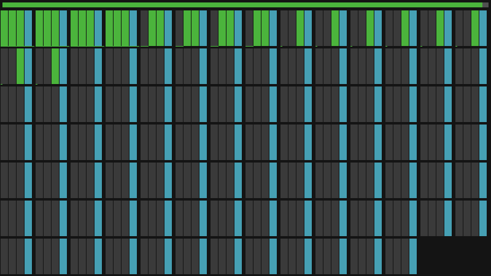

# 18_texture_streaming — Phase 33 streaming under a budget

A camera flies down a corridor lined with 400 wall panels, each with its own
2048x2048 BC1 texture and full mip chain: 1.07 GiB of texture data against a
64 MiB video-memory budget, 16.7 times oversubscribed.

Every frame the sample projects each panel, reports the mip it needs and its
screen coverage to the `TextureStreamer`, and calls `Update`. Reads happen on
two background IO threads at below-normal priority, with simulated storage
latency and bandwidth; uploads land in a page pool the size of the budget,
standing in for a GPU heap. The run is paced at 60 Hz in real time for 1,800
frames.



## Build and run

From the repository root:

```powershell
cmake --preset release
cmake --build --preset release --target cyber_sample_texture_streaming
.\build\release\samples\18_texture_streaming\cyber_sample_texture_streaming.exe
```

Pass an output prefix as the first argument (with a trailing separator) to
choose where the residency-view images go, and `--frames N` to change the run
length.

## What it reports

- The demand against the budget, and the tails loaded before the first frame.
- Streaming update time on the main thread per frame: mean, p99, maximum, and
  the number of frames over the 2 ms hitch line.
- Peak page use against the pool, uploads, and evictions.
- How many levels the view is waiting for, and whether any texture was ever
  without its placeholder tail.
- The five slowest updates with what each did, so a spike can be attributed.
- `PASS` when there were no hitches, the budget held, and every texture was
  always drawable; the exit code is non-zero otherwise.

It writes `texture_streaming_frameNNNN.ppm` residency views at a quarter, half
and the end of the run. Colours: green resident and needed, blue resident but
finer than needed, yellow loading, red needed and missing, grey not needed,
teal the packed tail. The bar across the top is the page budget.
